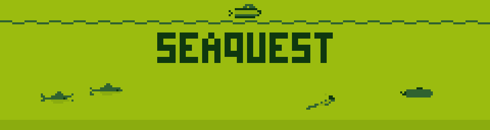
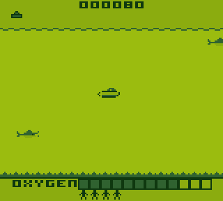
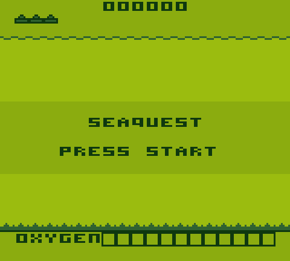
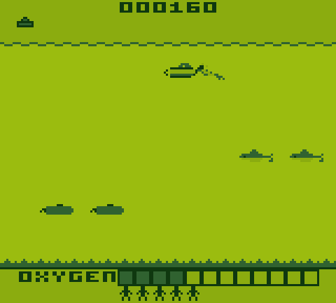
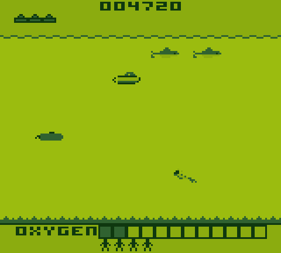
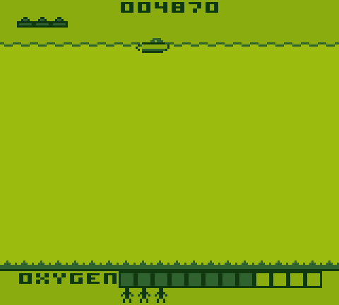
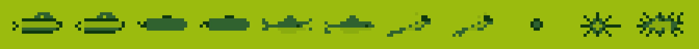

<p align="center">
  
</p>

<p align="center">
  <strong>The 1983 Atari classic, rebuilt from scratch for the original Game Boy.</strong><br>
  Rescue the divers. Watch your oxygen. Don't come up empty.
</p>

<p align="center">
  
  
  
  
</p>

<p align="center">
  
</p>

## About

This is a fan-made clone of *Seaquest* (Steve Cartwright, Activision, 1983) for the
original Game Boy, written in C. You pilot a submarine through shark-infested waters,
pick up stranded divers and race back to the surface before your oxygen runs out.
Then you do it all again, faster.

It was built by a human and an AI, together, and we had a great time doing it.
[Read how below.](#made-by-a-human-and-an-ai)

## Features

- **The full game loop:** rescue six divers, surface, cash in, and face a faster wave
- **Sharks and enemy subs** in groups from both sides, plus torpedoes aimed your way
- **The oxygen race:** a draining tank, a blinking bar and an alarm when it's almost gone
- **The surface patrol:** from wave 2, even coming up for air is dangerous
- **The on-screen count:** each diver and every drop of oxygen left turns into points
- **Extra subs** every 10,000 points, up to six in reserve
- **Animated sprites:** turning propellers, biting sharks, kicking divers
- **Sound effects** on the Game Boy's own sound chip, with no music
- **A steady 60 frames per second**, even with the screen full of enemies

## Screenshots

<table>
  <tr>
    <td></td>
    <td></td>
  </tr>
  <tr>
    <td align="center"><em>Press START</em></td>
    <td align="center"><em>Sharks to the right, subs below, one more diver to go</em></td>
  </tr>
  <tr>
    <td></td>
    <td></td>
  </tr>
  <tr>
    <td align="center"><em>Two blocks of oxygen left. Time to go.</em></td>
    <td align="center"><em>Six divers home: time to count the points</em></td>
  </tr>
</table>

Every image here is captured from the real ROM by [`tools/make_media.py`](tools/make_media.py),
colored with the green of the original Game Boy screen. In the GIF, a small bot is doing
the playing, and it's not very good. You can beat it.

Every frame of the cast, drawn on an 8×8 tile grid:

<p align="center">
  
</p>

## How to play

| Game Boy | Action | Keyboard in mGBA |
|---|---|---|
| D-Pad | Move | Arrow keys |
| A | Fire (hold to keep firing) | X |
| START | Start the game | Enter |

Touching an enemy or a torpedo costs you a sub. So does running out of oxygen. What
happens when you surface depends on who's on board:

| Divers on board | At the surface |
|---|---|
| **6** | They all go home. You score each diver plus your leftover oxygen, and the next wave begins |
| **1 to 5** | You refill, but one diver is left behind |
| **0** | Your sub is destroyed. Never come up empty! |

You start with 3 reserve subs. Enemies are worth more, and move faster, with every wave.

## Build and run

You'll need [GBDK-2020](https://github.com/gbdk-2020/gbdk-2020) (we use 4.5.0) unpacked in
`./gbdk/`, `make`, and any Game Boy emulator.

```sh
make        # builds Seaquest.gb
make run    # builds and opens it in mgba-qt
```

`Seaquest.gb` is a plain 32 KB ROM, so it should run in any Game Boy emulator. We've
tested it in emulators so far, not on real hardware.

## Made by a human and an AI

Seaquest GB was made by **[Carlos Costa](https://github.com/Carlos1Costa)** and
**[Claude](https://claude.com/claude-code)**, Anthropic's AI, working side by side
in Claude Code. It was a mix of two ways of building:

- **Spec-driven development (SDD).** Carlos started with a written spec: the rules of the
  game, the hardware limits, a backlog of epics and acceptance criteria, and engineering
  principles such as "no macros" and "few cohesive files". Claude worked from that spec,
  one epic at a time.
- **Vibe coding.** The rest was a conversation. Carlos played each build and said what
  felt wrong (like the game slowing down during a firefight), and Claude dug in, measured,
  and fixed it. Decisions about how the game should feel were always a human call, and
  research on the original kept making it more faithful.

Along the way the game hit 30 fps with a screen full of enemies. Claude profiled the
ROM line by line, and we rebuilt the hot paths until it held 60 fps. A later spec, written
after playing, brought the animations, the art and the oxygen refill sound.

Above all, **we had a lot of fun making this.** We hope you have fun playing it. 🌊

The specs are in the repository, in Portuguese, the language of the project's
conversations: [the main guide](GUIA_SEAQUEST_GB.md) and
[the art and sound refinement](REFINAMENTO_ARTE_SOM_SEAQUEST_GB.md).

## Under the hood

The Game Boy is a tiny machine: an 8-bit CPU at about 4 MHz and at most 10 sprites per
scanline. Some of what it took to fit the game in:

- **Fixed-point math** for smooth movement at sub-pixel speeds, with no floating point
- **Lanes and groups** that keep every scanline within the 10-sprite limit
- **Hand-tuned hot paths:** bitmasks instead of loops over empty slots, 8-bit collision
  boxes, and direct sprite writes. The worst frame measured in play uses about 92% of
  the time available
- **Decimal score digits**, because the CPU has no divide instruction, and turning a
  32-bit number into digits took more than a whole frame
- **Sound by register:** each effect is a single write, and the hardware does the rest

The test suite runs the real ROM in the [PyBoy](https://github.com/Baekalfen/PyBoy) emulator.
It presses buttons, reads memory, and fails if a frame goes over budget:

```sh
make test-env   # once: creates the Python environment in .env/
make test       # rebuilds the ROM and runs every test
```

More in [tests/README.md](tests/README.md).

## Project layout

```
src/         the game: main.c, game.c/.h, collision.c/.h, sound.c/.h
res/         pixel art (PNG)
tests/       test suite (PyBoy + pytest)
tools/       art and README image generators (make art, make media)
docs/images/ the images in this README
```

## License

Released under the [GNU GPLv3](LICENSE).

This is an unofficial, non-commercial fan project. *Seaquest* and Activision are trademarks
of their respective owners, and this project isn't affiliated with or endorsed by them.
No original code or assets were used.
